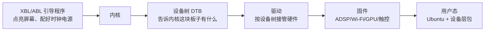
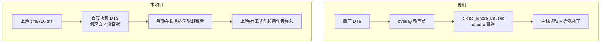

# 技术路线与同类项目对比

本文解释本项目把主线 Linux 带到小米平板 8 Pro 的方式，与社区其他 piano 项目的差别，以及显示路径和刷新率的取舍。

## 1. 一台安卓平板上的 Linux 要解决什么



引导程序接手前已经把屏幕点亮、时钟和电源配好。内核启动后要么**接管**这些硬件，要么**保留**引导程序留下的状态。接管得对，就能换分辨率、息屏、挂起；接管得不对，就黑屏、锁死。这是所有 piano 移植项目的共同难点。

## 2. 两条路线

| | 本项目 | blu-sharky / SunUEFI（linux-piano、debian-piano） | BigfootACA/linux |
|---|---|---|---|
| 内核基线 | 上游稳定版 v7.2.6 | v7.2.6 | v7.1.3 |
| 设备树 | 上游 `sm8750.dtsi` + 自写板级 DTS，按上游绑定，每个值从本机原厂证据推导 | 原厂安卓内核的 DTB + 反编译的原厂 dtbo overlay + 自己的 overlay 补丁 | 自写 DTS（与本项目同类） |
| 资源管理 | 内核正常管理时钟/电源域/互连；固件仍在用的资源在设备树里声明消费者 | 命令行 `clk_ignore_unused pd_ignore_unused iommu.passthrough=1`：不关任何引导程序留下的时钟和电源域，IOMMU 直通 | 内核正常管理 |
| 显示 | 当前固件扫描输出 + simpledrm；原生 MDSS/DSI 进行中 | 原生 MDSS/DSI + 自写面板驱动 | 原生 MDSS/DSI + 自写面板驱动 |
| 驱动来源 | 上游优先，社区提交按原作者 cherry-pick | 自写 + 社区 | 自写 + 上游 |
| 用户态 | 官方 Ubuntu + 独立设备层包，不内置账户 | Debian，整盘占用 userdata | 侧重 Windows on ARM |
| 可上游化 | 是（除登记的临时补丁） | 否（依赖原厂 DTB 与绕过） | 部分 |

### 2.1 "原厂 DTB + overlay" 是什么意思

原厂安卓内核自带一份设备树，描述了这块板子的全部硬件：每个电源轨、GPIO、面板时序、DSC 参数、音频接口。直接用它启动主线内核，板级事实一个不用查。代价是：这份设备树是按高通下游驱动的绑定写的，主线驱动大多读不懂，所以要么改驱动迁就下游属性，要么用 overlay 一个个改节点；并且必须关掉主线的资源回收（`clk_ignore_unused` 等），否则内核会把引导程序留下的、设备树里没有消费者的时钟关掉——那正是黑屏的来源。

### 2.2 本项目怎么做

从上游 `sm8750.dtsi` 出发，板级节点逐个按上游绑定写，每个数值（电源电压、GPIO、I2C 地址、DMIC 引脚、PCIe 供电）从本机原厂设备树、运行时 FDT 或 PMIC 寄存器读数推导并记录来源。固件仍在使用的显示资源，用标准的 OPP 表和电源域声明挂在 `simple-framebuffer` 节点上，让内核的 sync_state 机制自然保住它们，而不是全局禁止回收。



### 2.3 利弊

- **他们**：起步快，硬件事实全有；但不省电（什么都不关）、无隔离（IOMMU 直通）、挂起/息屏难做、不能上游、原厂 ROM 一更新 DTB 就可能失配。
- **本项目**：每个事实都要查，早期踩的坑多（黑屏、灰屏、GPU 锁死都是资源声明缺失）；但解决后是干净的内核行为，省电和挂起有路可走，补丁能投上游，和发行版解耦。

### 2.4 能不能直接用别人的代码

可以，而且已经在用：驱动和用户态按提交保留原作者导入（BigfootACA 五项修正、ath12k QDSS 与 5 GHz 修正、FS19xx 驱动、MCA 充电客户端参考、debian-piano 的 UCM 结构）。不能直接搬的是三类：原厂 DTB 本身、别人板级的数值（电压、阈值、校准）、以及违反内核资源模型的绕过（全局不回收时钟、IOMMU 直通）。

## 3. 显示：固件扫描输出与原生驱动

```mermaid
flowchart LR
    subgraph 现在：固件扫描输出
        F1[引导程序配好 DPU/DSI/面板<br/>固定 3200x2136 120Hz] --> F2[DPU 持续扫描一块内存]
        F2 --> F3[simpledrm 只往这块内存画]
        F3 --> F4[GNOME：能显示，连接器类型 Unknown<br/>无亮度滑块、无息屏、无外屏、无模式切换]
    end
```

```mermaid
flowchart LR
    subgraph 目标：原生显示
        N1[内核 msm 驱动复位并接管 DPU/DSI] --> N2[面板驱动初始化 P81]
        N2 --> N3[GNOME 看到内置 DSI 连接器]
        N3 --> N4[亮度滑块、息屏/唤醒、刷新率切换、DP 外屏、挂起]
    end
```

"原生"指内核自己的显示驱动在编程硬件，而不是沿用引导程序留下的状态。上游 msm 没有无缝接管：MDSS 探测先复位，所以接管时会黑一下；BigfootACA 和 blu-sharky 也是这样。本项目的做法是分步、每步一次 RAM 启动、无需目视的判据，细节见设计文档。

### 3.1 为什么先 120 Hz

面板支持 90/120/144 Hz，原厂安卓跑 144。上游 DPU 驱动按 3200×2136 和行/场消隐算出 144 Hz 需要 577.3 MHz 的 MDP 时钟，超过 SM8750 目录里 575 MHz 的上限，直接拒绝该模式；blu-sharky 在本地改了这条公式才开到 144。固件现在扫描的是 120 Hz，所以先在 120 Hz 完成接管，不引入额外变量；144 Hz 之后再做，优先找一个上游能接受的算法修正（例如考虑 DSC 压缩后的实际带宽），其次才是本地补丁。

## 4. 开源节奏

不等全部功能就绪。首版只包含已经真机验证的内容，其余在支持矩阵里标明状态，逐版补齐。

| 版本 | 内容 | 状态 |
|---|---|---|
| v0.1.0-preview | 内核与集成源码、固件、Ubuntu 启动镜像集、根文件系统镜像、切换/恢复工具、手动安装文档；显示（固件扫描）、GPU、触控、键盘、蓝牙扫描、Wi-Fi 扫描、电量、USB 调试 | 发布物已生成，待公开 |
| v0.2 | 安装器自动化、扬声器、麦克风录音验收、充电电流控制、Wi-Fi 连接、原生显示（接管与亮度） | 进行中 |
| v0.3 | 息屏/唤醒、挂起、传感器与自动旋转、手写笔、USB 主机与外屏 | 计划 |
| 之后 | 相机、指纹、视频硬解、144 Hz | 计划 |
